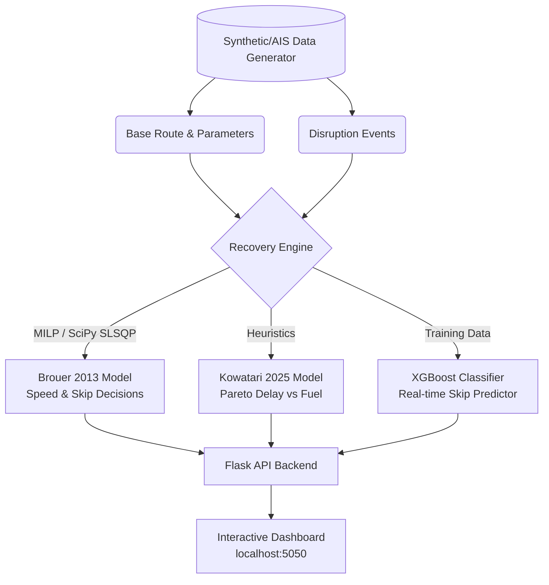

# Vessel Schedule Recovery Problem (VSRP) — Proof of Concept

This repository contains an interactive proof-of-concept (POC) dashboard for the **Vessel Schedule Recovery Problem (VSRP)**. It models how container liner shipping services (like THE ALLIANCE FP1) can recover from severe port congestion using a mix of traditional operations research, multi-agent simulation, and machine learning.

The POC was built as a preliminary model to bridge the gap between deterministic optimization and predictive recovery strategies.

## Theoretical Framework

The implementation is grounded in three core paradigms from recent maritime logistics literature:

1. **Exact Optimization (MILP):** Implements the objective function from Brouer et al. (EJOR 2013) to find the globally optimal trade-off between vessel speed-up (cubic fuel costs) and port skipping penalties.
2. **Multi-Agent Simulation:** Replicates the heuristic recovery strategies and Pareto frontiers from Kowatari & Shibasaki (IEEE BigData 2025).
3. **Data-Driven Prediction (ML):** Uses an XGBoost classifier inspired by Ocean Engineering (2025) to predict port skip probabilities in real-time based on congestion and vessel parameters.

## Architecture & Workflow

The system is built with a Python backend (Flask + SciPy SLSQP + XGBoost) and a vanilla HTML/JS frontend. Data generation is currently calibrated to synthetic empirical parameters (Watanabe et al. 2024), but the pipeline is designed to ingest real AIS data in future iterations.



## Quick Start

You'll need Python 3.9+ installed. The launch script will automatically handle dependencies, pre-compute the simulation sweeps, and spin up the dashboard.

```bash
# Clone the repository
git clone https://github.com/somya130104/vsrp_poc.git
cd vsrp_poc

# Launch the full pipeline
bash start.sh
```

Navigate to `http://localhost:5050` in your browser.

## Repository Structure

* `src/data_generator.py` - Synthetic routing and congestion data creation.
* `src/vsrp_optimizer.py` - Scipy-based SLSQP solver for the Brouer 2013 formulation.
* `src/simulation_agent.py` - Multi-agent heuristics replicating Kowatari 2025.
* `src/ml_classifier.py` - XGBoost model for binary port-skip classification.
* `app.py` - Flask server exposing the model endpoints.
* `dashboard/` - Frontend UI assets (HTML, CSS, JS).
* `data/` - Generated JSON/CSV outputs (created on first run).
